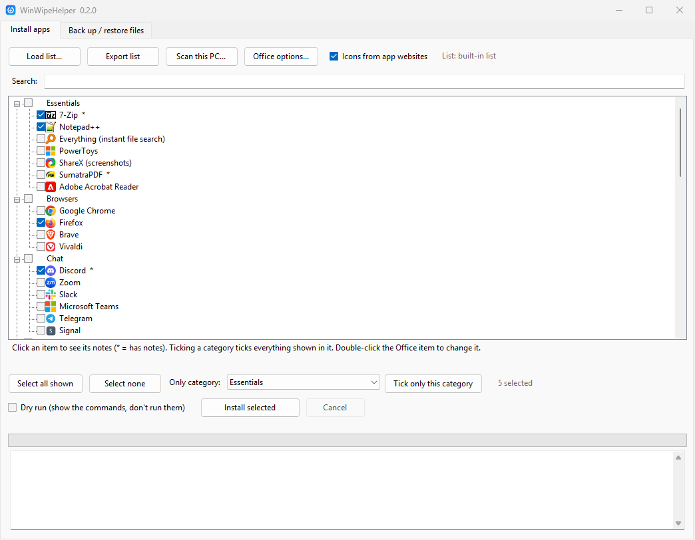
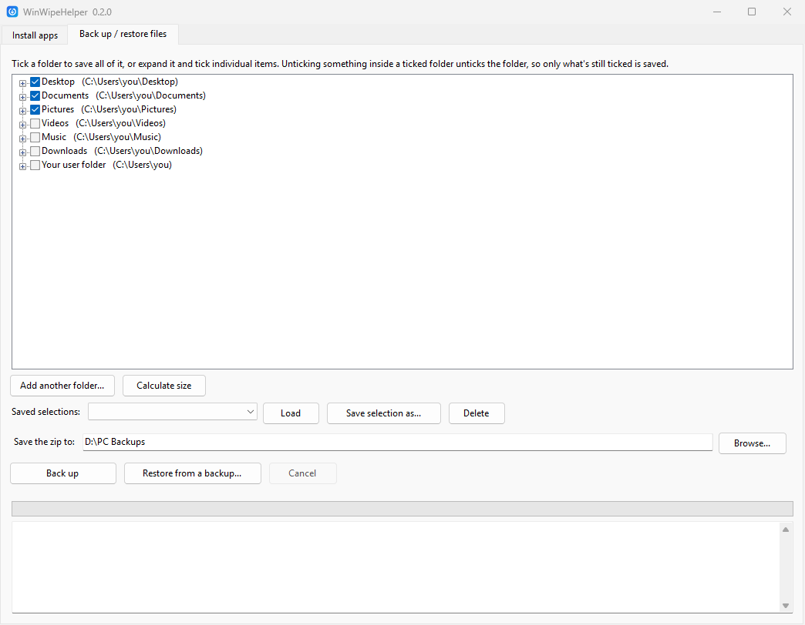

# WinWipeHelper

A small Windows program for reinstalling Windows without losing a day to it:

- **Install apps**: tick the apps you want and they install silently through **winget**, Microsoft's package manager. It works like Ninite, with an app list you can edit.
- **Back up / restore files**: zip your folders before the wipe and put them back afterwards in the right places, even if your username changed.

It's one `.exe` and needs **nothing installed**: it runs on any Windows 10 (1903 or newer) or Windows 11 PC.



**New here?** Follow the step-by-step [guide to reinstalling Windows](docs/GUIDE.md). Questions? See the [FAQ](docs/FAQ.md).

## Download

Get `WinWipeHelper.exe` from the [Releases](../../releases) page and put it on a USB stick or a second drive.

### "Windows protected your PC" (SmartScreen)

The EXE isn't code-signed (certificates cost money every year), so the first time you run it Windows may show a blue **"Windows protected your PC"** box. To run it:

1. Click **More info**.
2. Click **Run anyway**.

Windows remembers this for that file. Free code signing has been applied for (see [Code signing policy](#code-signing-policy)). If you'd rather not trust a download, build it yourself (see [Building](#building)); it takes about a minute.

## Install apps

- A checklist grouped by category, with search. Ticks stay put while you search.
  **Select all shown**, **Select none**, and **Only category** help pick quickly.
- Apps install with `winget install --exact --source winget --silent`, straight from each vendor's download, hash-checked by winget.
- **Dry run** shows every command it would run, without running anything.
- Needs admin? You get **one** UAC prompt for the whole batch. Apps that refuse to install as admin (Spotify, for example) are installed as your normal user automatically.
- **Download-only items** go to `Desktop\Installers`. Each file must carry a valid digital signature from the expected company; anything that fails goes into `_NOT VERIFIED - do not run`.
- **Microsoft Office**: choose the license type (Microsoft 365 Personal/Family, Business, Apps for enterprise, Office 2024 Home, Office 2024 Home & Business) and which apps you want. It installs through Microsoft's **Office Deployment Tool**, and you activate by signing in to Office.
- **No winget yet?** On a fresh PC (or Windows Sandbox) WinWipeHelper repairs or installs winget itself, **without the Microsoft Store**. First it re-registers the App Installer that ships with Windows. If that doesn't work, it downloads App Installer from Microsoft's official [winget-cli releases](https://github.com/microsoft/winget-cli/releases) and checks the signatures first.
- At the end you get a summary and a page of links for things that can't be automated, such as graphics drivers.
- **Icons** next to each app: apps that are already installed show their own icon. The first time you start WinWipeHelper, it asks whether it may download icons for the other apps. If you say yes, it downloads each icon from the app's own website (its `homepage`; for GitHub projects, the owner's avatar) and keeps it in `%LOCALAPPDATA%\WinWipeHelper\icons`, so each site is asked only once. If you say no, nothing goes online for icons and those apps get a colored letter. **Icons from app websites** changes your answer later.

### Your own app list (`apps.json`)

The built-in list is a starter set of popular apps, all unticked except 7-Zip and VLC. To make your own:

- **Export list** saves the list with your ticks as `apps.json`. Put `apps.json` **next to the EXE** and it's used automatically from then on.
- **Load list...** opens another list.
- **Scan this PC...** builds a list from what's installed on the PC you're about to wipe (see below).

```json
{
  "version": 1,
  "categories": ["Essentials", "Media"],
  "apps": [
    { "id": "7zip.7zip", "name": "7-Zip", "category": "Essentials", "default": true, "homepage": "https://7-zip.org" },
    { "id": "Spotify.Spotify", "name": "Spotify", "category": "Media", "default": false, "user": true,
      "note": "Installed as your normal user." },
    { "id": "Microsoft.VisualStudio.2022.BuildTools", "name": "VS Build Tools", "category": "Development",
      "override": "--quiet --wait --norestart --add Microsoft.VisualStudio.Workload.VCTools --includeRecommended" },
    { "id": "office", "name": "Microsoft Office", "category": "Office", "kind": "office",
      "office": { "product": "O365HomePremRetail", "apps": ["Word", "Excel"], "language": "MatchOS", "edition": "64" } },
    { "id": "dl.example", "name": "Some launcher", "kind": "download", "url": "https://vendor.example/setup.exe",
      "fileName": "setup.exe", "signer": "Vendor Inc" },
    { "id": "dl.github", "name": "A GitHub app", "kind": "download", "github": "owner/repo", "assetPattern": "\\.msi$",
      "signer": "Vendor Inc" }
  ],
  "manualLinks": [
    { "name": "Graphics driver", "url": "https://www.nvidia.com/en-us/drivers/", "note": "NVIDIA cards only" }
  ]
}
```

| Field | Meaning |
|---|---|
| `id` | winget package id (find one with `winget search <name>`) |
| `default` | ticked when the list opens |
| `user` | install as the logged-in user, without admin |
| `override` | passed to the installer with `winget --override` |
| `kind` | `winget` (default), `download` or `office` |
| `homepage` | the app's website; its icon is shown while the app isn't installed (`tools/fill-homepages.ps1` fills it in from winget) |
| `url`, `fileName`, `signer` | download-only items: where from, what to call it, and who must have signed it |
| `github`, `assetPattern` | take the newest release asset of `owner/repo` whose name matches the pattern (a regular expression) |

### Scan this PC

**Scan this PC** looks for programs in several places, because each source on its own misses some:

1. `winget export` **and** `winget list`
2. The registry's uninstall entries: machine-wide, 32-bit, your user, and other loaded user profiles
3. Start Menu and Desktop shortcuts, including `.url` game shortcuts
4. Top-level folders in Program Files, `%LOCALAPPDATA%\Programs` and `%APPDATA%` that contain programs, which catches portable apps
5. Startup entries: Startup folders, `Run`/`RunOnce` keys and scheduled tasks
6. Game launchers: Steam, Epic, EA, Ubisoft, Rockstar, GOG and Battlestate. Games are listed as "reinstall from <launcher>"
7. Optional sources: Microsoft Store apps, Chocolatey and Scoop

The scan then merges duplicates and matches each program to winget, first through winget itself and then with a careful `winget search`. It sorts items into apps, runtimes, drivers, games, Windows components and leftovers, which are entries pointing at files that no longer exist. You review everything: tick or untick items, and fix any winget ID the scan wasn't sure about (those rows are yellow). Then save the result as `apps.json`. The scan doesn't need admin. It asks only if you want other users' profiles included.

## Back up / restore files



- Tick whole folders or individual files. **Add another folder...** adds any folder, and **Calculate size** shows how much will be saved.
- **Saved selections**: name a selection and load it again next time. Your last selection is remembered too.
- Files from Desktop, Documents, Pictures, Videos, Music, Downloads and your user folder are stored by **folder type**, so on the new install they go back into *your* folders, even if the username changed or OneDrive moved them. Anything else, like `D:\Projects`, goes back to the same path.
- Files that are open in other programs are still read. Links, junctions and online-only OneDrive files are skipped and listed in `<backup>.skipped.txt`.
- Photos, videos, archives, PDFs and Office files are stored without recompressing; everything else uses fast compression. Backups over 4 GB work (Zip64).
- The zip goes next to the EXE if that's not on C:, otherwise to the non-C: drive with the most free space (D: preferred), in a `PC Backups` folder. WinWipeHelper warns you if the destination is on C:, which gets wiped.
- **Restore** finds your newest `Files-Backup-*.zip` and shows each folder with where it will go. If a file already exists, you choose: **Skip**, **Overwrite** or **Keep both**. Modified dates are kept.
- Backups and restores run as you, not as admin, so restored files belong to you.

## Privacy

This program will not transfer any information to other networked systems unless specifically requested by the user or the person installing or operating it.

In practice, WinWipeHelper goes online only for what you start: installing apps (through winget, or from the download address listed for an item), repairing winget, and, if you agreed at first start, downloading app icons from the apps' own websites. There's no account, no tracking and no telemetry. Backups and restores never go online.

## Code signing policy

> **Status:** applied for. Releases are unsigned until SignPath Foundation approves the project.

Free code signing provided by [SignPath.io](https://about.signpath.io/), certificate by [SignPath Foundation](https://signpath.org/).

- **Committers and reviewers:** the owner of this repository
- **Approvers:** the owner of this repository

Only release builds made by GitHub Actions from this repository's source code are signed, and each signing request is approved by hand.

## Logs

Every action writes a log to a `logs` folder next to the EXE. If that folder can't be written to, logs go to `%LOCALAPPDATA%\WinWipeHelper\logs`.

## Building

You need the [.NET SDK](https://dotnet.microsoft.com/download) (8 or newer) to **build**. Users don't need anything, because the EXE targets .NET Framework 4.8, which is part of Windows.

```powershell
.\build.ps1            # writes artifacts\WinWipeHelper.exe
```

GitHub Actions builds every push. Tags (`v1.2.3`) create a release with the EXE attached after the `release` environment approves it.

To test on a genuinely fresh Windows, see [sandbox/TESTING.md](sandbox/TESTING.md).

## License

MIT
