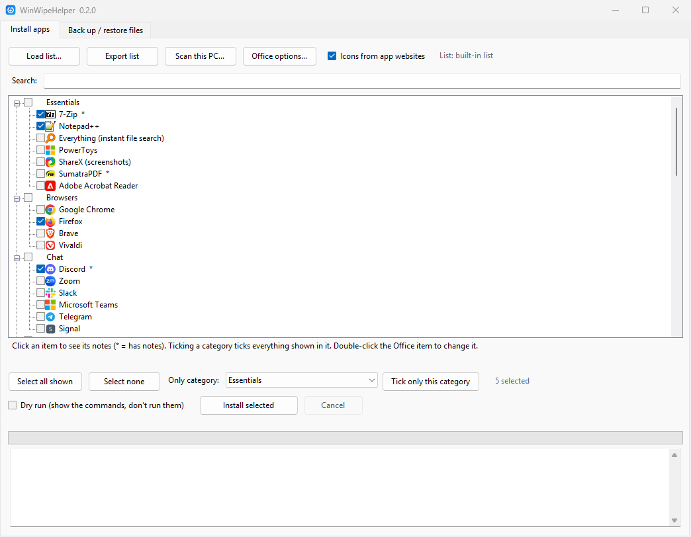
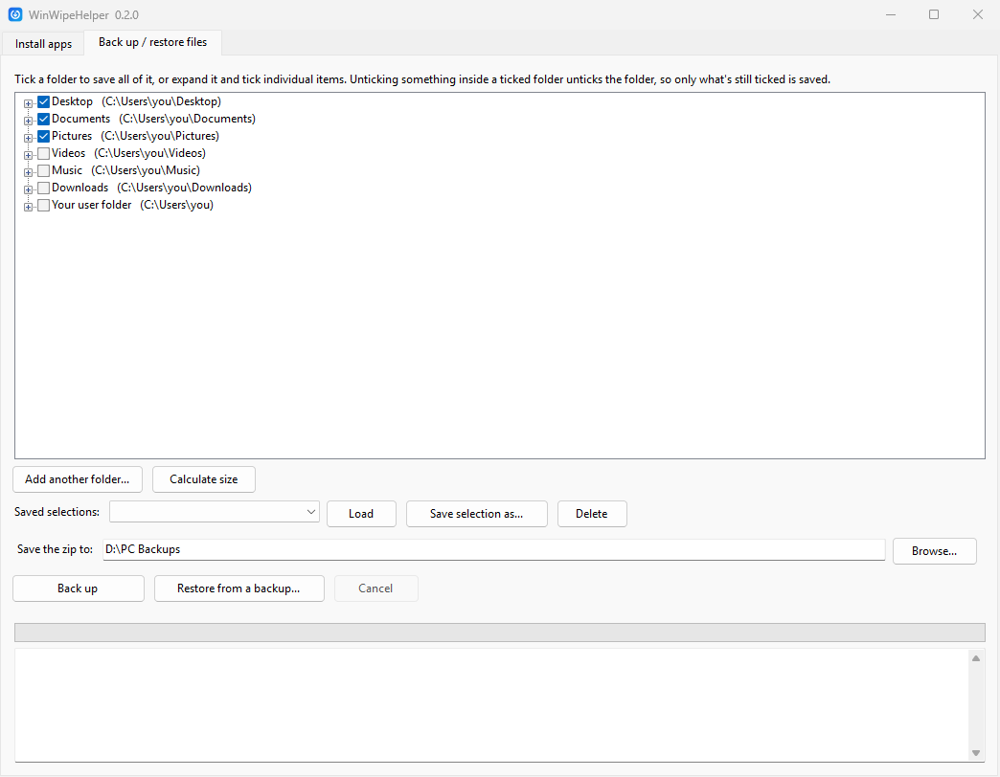
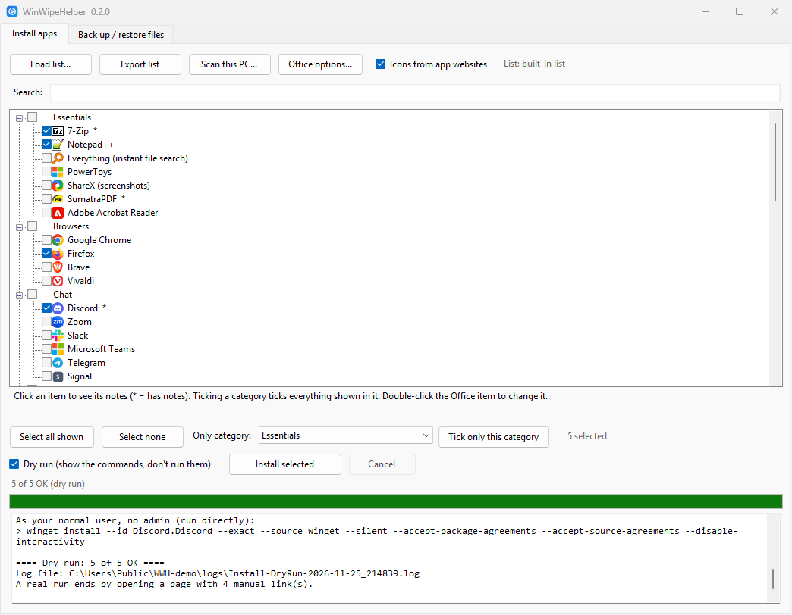
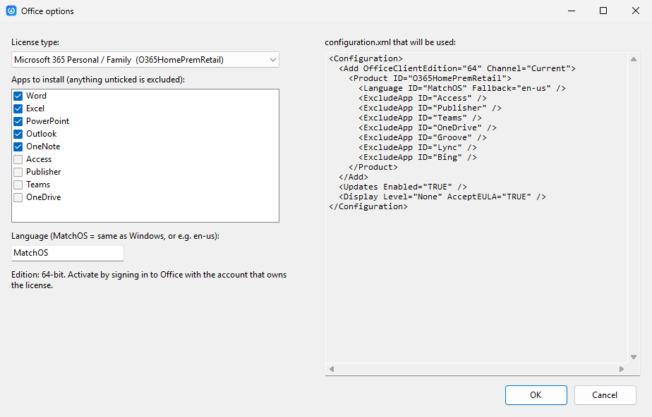

# How to reinstall Windows with WinWipeHelper

This guide walks through a full wipe-and-reinstall: what to do **before** you wipe the PC, and what to do **after** Windows is installed again. It takes about 15 minutes of your time, plus the time the backup and installs run on their own.

You need:

- `WinWipeHelper.exe` (see [Download](../README.md#download))
- A place that **won't be wiped** for the backup: a second drive (D:), an external drive or a big USB stick

> **Tip:** Try everything first with **Dry run** ticked. It shows exactly what would happen without installing anything.

---

## Before you wipe

### 1. Put WinWipeHelper somewhere safe

Copy `WinWipeHelper.exe` to the USB stick or second drive that will survive the wipe, and run it from there. Anything you save next to the EXE (your app list, logs, backups) is then still there afterwards.

The first time, Windows may show **"Windows protected your PC"**. Click **More info**, then **Run anyway**. [Why does this happen?](FAQ.md#why-does-windows-say-it-protected-my-pc)

WinWipeHelper then asks once whether it may download app icons from the apps' websites. Either answer is fine: it only changes the little icons next to app names.

### 2. Make your app list

Open the **Install apps** tab. You can build the list two ways:

**Scan this PC (recommended).** Click **Scan this PC...**, then **Start scan**. It finds the programs installed on this PC and matches each one to winget. Then:

1. Look through the results. Untick anything you don't want back.
2. Check the yellow rows: the scan wasn't sure about their winget ID. Type the right ID in that row (find it with `winget search <name>`), or untick them.
3. Click **Save as apps.json...** and save it **next to the EXE**.

**Or tick from the built-in list.** Tick the apps you want, then click **Export list** and save `apps.json` next to the EXE.

Either way, next time WinWipeHelper starts it opens your list, with your ticks.

### 3. Back up your files

Open the **Back up / restore files** tab.

1. Tick the folders you want to keep. Expand a folder to tick only some of what's inside.
2. Use **Add another folder...** for anything outside your user folders, like `D:\Projects` or a game's save folder.
3. Click **Calculate size** to check it fits.
4. Check **Save the zip to**. It must **not** be on C:, because C: gets wiped. WinWipeHelper picks another drive for you and warns you if you choose C:.
5. Click **Back up**.

When it's done you have `Files-Backup-<date>.zip` in that folder. If some files couldn't be saved, they're listed in a `.skipped.txt` file next to the zip. Have a quick look at it.

**Want the same selection next time?** Click **Save selection as...** and give it a name.

### 4. Things WinWipeHelper doesn't save

Check these yourself before you wipe:

- **Passwords and browser data.** Sign in to your browser's sync, or export your passwords.
- **License keys** for paid software you'll need to activate again.
- **Settings stored in AppData**, such as some game saves and app settings. Add those folders with **Add another folder...** if you need them.
- **Drivers.** You'll download these fresh afterwards (step 8).

### 5. Double-check before you wipe

On the drive that survives the wipe you should have:

- `WinWipeHelper.exe`
- `apps.json`
- `Files-Backup-<date>.zip`

Now reinstall Windows.

---

## After the reinstall

### 6. Install your apps

1. Run `WinWipeHelper.exe` from the USB stick or second drive. Your `apps.json` loads automatically.
2. If you want Microsoft Office, click **Office options...** and choose your license type and apps (see below).
3. Optional: tick **Dry run** and click **Install selected** to see the exact commands first.
4. Untick **Dry run** and click **Install selected**.

Windows asks for admin permission **once** for the whole batch. Apps that must be installed as your normal user (such as Spotify) are handled automatically.

On a brand-new Windows, winget sometimes isn't ready yet. WinWipeHelper fixes or installs it first, without the Microsoft Store.

When it finishes you get a summary of what installed, what was already there and what failed. Then a page opens with links for things that can't be installed automatically, such as graphics drivers.

#### Microsoft Office

Choose the **license type** you own (for example Microsoft 365 Personal / Family) and tick the apps you want. Office is installed by Microsoft's own Office Deployment Tool. Afterwards, open Word or Excel and **sign in** with the account that owns the license to activate it.

### 7. Restore your files

Run WinWipeHelper as your normal user (not "Run as administrator"), so the restored files belong to you.

1. Open **Back up / restore files** and click **Restore from a backup...**.
2. WinWipeHelper finds your newest backup. Click **Yes** to use it, or **No** to pick a different zip.
3. Check where each folder will go. Your Desktop, Documents, Pictures and so on go back into *your* folders, even if your username is different now or OneDrive moved them.
4. Choose what happens when a file already exists: **Skip**, **Overwrite**, or **Keep both**.
5. Click **Restore**.

### 8. Drivers and the rest

Use the links page from step 6 to get your graphics driver and anything else that can't be automated. Your PC or motherboard maker's support page has the rest (chipset, network, audio).

You're done. Keep the USB stick with `WinWipeHelper.exe` and `apps.json` for next time.

---

Something not working? See the [FAQ](FAQ.md). Every action also writes a log to the `logs` folder next to the EXE.
